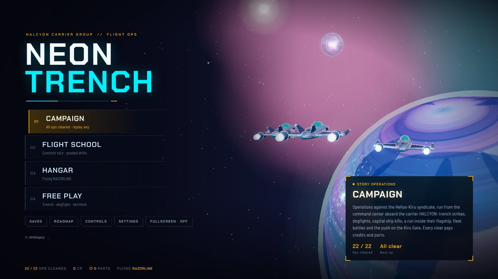
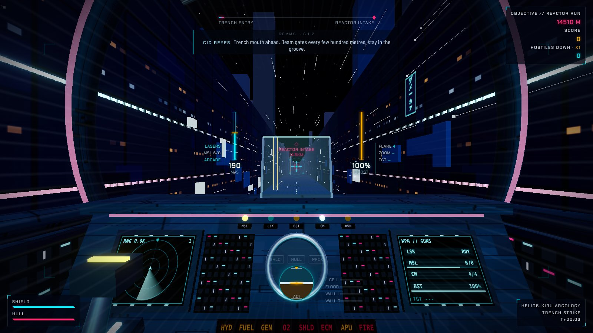
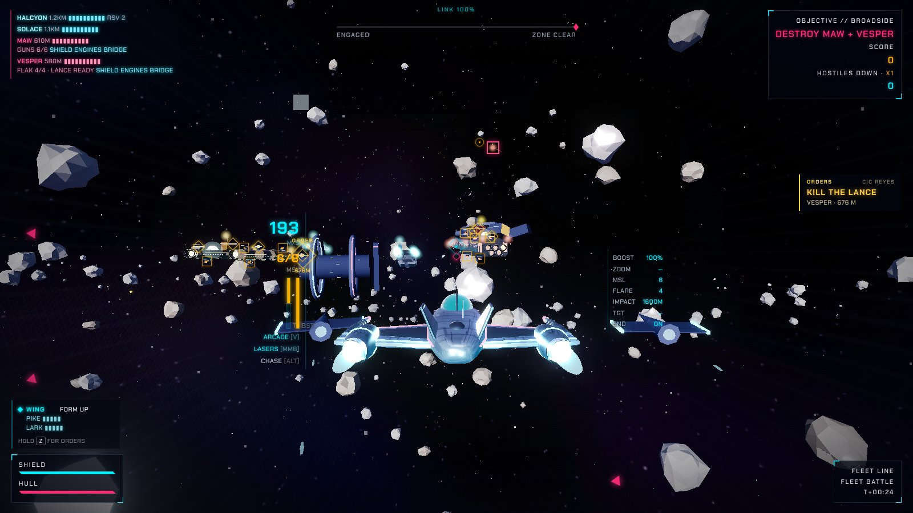
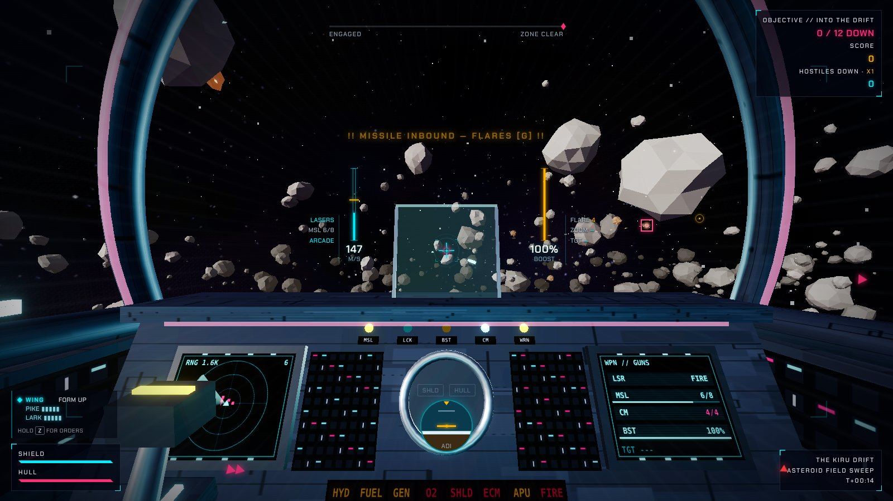
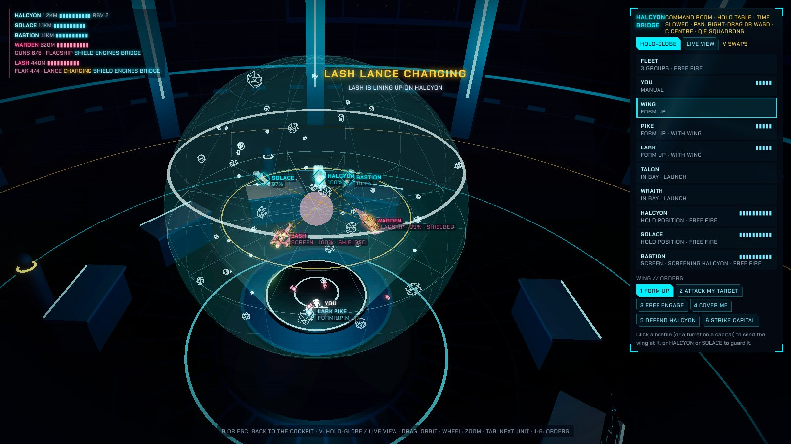
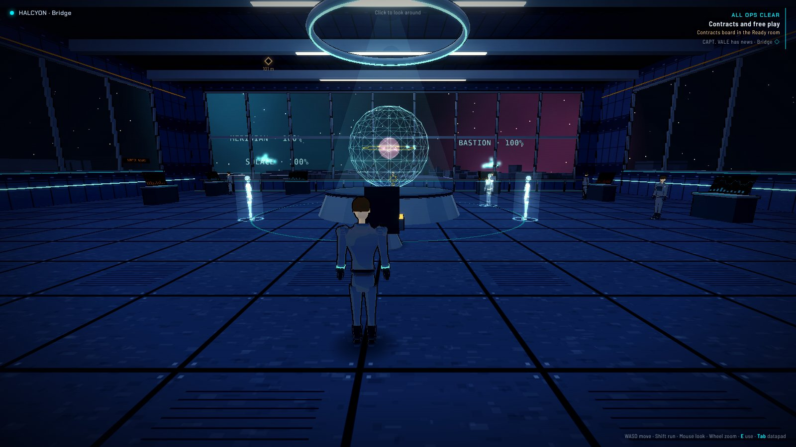
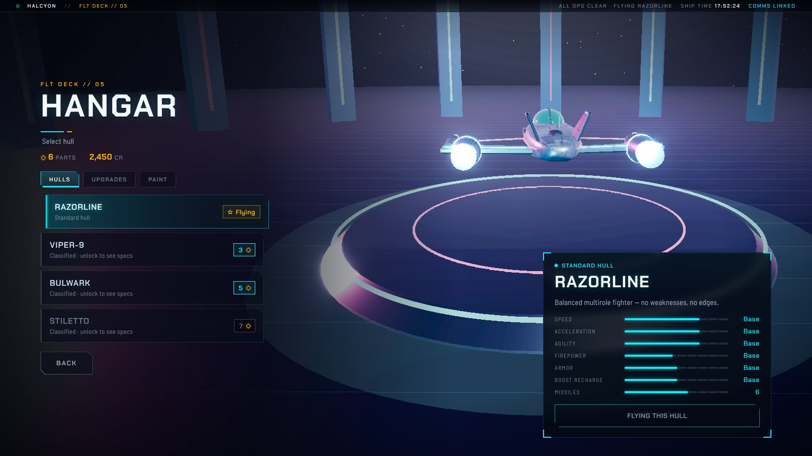

# NEON TRENCH // RUN

A neon sci-fi flight game in plain JavaScript and Three.js. Fly trench runs, dogfights and fleet battles across a
22-op campaign, walk the carrier HALCYON between sorties, and command its fleet from the bridge. Procedural meshes,
synthesized audio, a live cockpit, no build step and no asset files.



| | |
|---|---|
|  |  |
| *Trench run, from the cockpit* | *Broadside: the first fleet battle* |
|  |  |
| *Act V in the Kiru Drift* | *Commanding the fleet from HALCYON's holo-globe* |
|  |  |
| *HALCYON's deck, the campaign hub* | *The hangar: hulls, upgrades and paint* |

The screenshots are made by `node tools/screenshots.mjs` (see [Testing](#testing)); run it again after a visual change.

## How to play

No install, no build, no internet connection needed. All you need is a modern desktop browser
(Chrome, Edge, Firefox or Safari).

1. **Get the game.** On the GitHub page click **Code → Download ZIP** and unzip it, or clone it:
   `git clone https://github.com/czinabu/neon-trench.git`
2. **Open `index.html`.** Double-click it and it opens in your browser. Three.js is bundled in
   `vendor/`, so it runs straight from disk.
3. **Click to take control** (the game captures the mouse), then pick **Campaign** on the title
   screen. A new pilot gets a short intro and a tour of HALCYON's deck, and the first op (Reactor Run)
   starts with a training walkthrough; press Enter to skip it. **Flight School** on the title screen has
   graded drills if you want more practice.

Progress (credits, parts, ships, upgrades, mission clears) and settings are saved in your browser,
so they stay on the computer and browser you played on.

### Play it from a link (optional)

The game is hosted on [Vercel](https://vercel.com), which deploys `main` on every merge (the free plan has a
daily deploy limit, so changes are batched into few pull requests). Vercel also runs `api/turn.js`, a small
function that hands out relay logins so online co-op works on networks that block direct links between
players (it needs the `CF_TURN_KEY_ID` and `CF_TURN_API_TOKEN` environment variables; without them co-op falls
back to direct links, which work on most home networks). `.vercelignore` keeps the Windows app, docs, tests,
tools and the archive out of the deploy.

Any static host works too. GitHub Pages, for example: **Settings → Pages**, *Deploy from a branch*, `main`
and `/ (root)` (co-op's relay won't be there, but everything else is).

### Run it on localhost (optional)

If you have [Node.js](https://nodejs.org) installed, you can play it from a local link instead:

```
git clone https://github.com/czinabu/neon-trench.git
cd neon-trench
npm run dev
```

Open the `http://localhost:5173/` link it prints. There's nothing to install first. The page
reloads by itself whenever you save a change to the game's files, which makes it the easiest way to
work on the game. Other devices on the same network can open it at your computer's IP address on the
same port, which is handy for testing on a phone. Ctrl+C stops it.

### Windows app (optional)

The game also runs as a Windows program, and the installed version keeps itself up to date.

- **Get it:** open the latest [release](https://github.com/czinabu/neon-trench/releases/latest) and download
  `Neon Trench Setup <version>.exe`. It installs the game with Start-menu and desktop shortcuts. The release
  also has a portable exe (one file, no install), but that one can't update itself.
- **Updates:** each time a change to the game lands on `main`, a GitHub Actions workflow
  (`.github/workflows/windows-exe.yml`) builds the app and publishes a new release. Changes that only touch
  docs, tests or tools don't make a release. The installed game checks for a new release when it starts and
  every 30 minutes, downloads it in the background, shows a small note in the corner, and installs it the next
  time you close the game.
- The title screen shows the version (`v0.37.12`, say), which goes up with each update. On the website it shows
  the `version` in `package.json`.
- **Exit** on the title screen and **Exit game** in the pause menu close the app (they only show in the app).
  F11 toggles fullscreen. Saves are kept in the app, separate from the browser's.
- **Problems?** The app writes a log to `%APPDATA%\Neon Trench\neon-trench.log` (errors, the graphics card in use,
  update checks), and Ctrl+Shift+I opens the developer console.

Release versions are `MAJOR.MINOR.<build number>`, with MAJOR.MINOR from the root `package.json`, so each
release is newer than the last without anyone bumping a version.

To build it yourself on a Windows PC with [Node.js](https://nodejs.org): `cd desktop`, `npm install`,
`npm run build` (exes land in `desktop/dist/`). `npm start` in `desktop/` opens the game in the app window
without building. The app is a thin [Electron](https://www.electronjs.org) window (`desktop/main.js`) that
packs `index.html`, `css/`, `js/` and `vendor/` straight from the repo, so it always matches the web game.
The exe isn't code-signed, so the first time Windows may show "Windows protected your PC": click
**More info → Run anyway**.

## The game

- **Campaign**: 22 ops in five acts, each with a briefing, optional bonus objectives, a payout of credits
  and parts, and an S to C rank in the debrief.
  1. *Cold start* (Reactor Run to Ace Duel): trench strikes, open-space sweeps, a defensive stand, a stealth
     run and a duel with Kestrel's aces.
  2. *The wing* (Shipbreaker to Heart of the Throne): capital ship strikes, defending HALCYON and a run down
     the inside of the dreadnought THRONE.
  3. *The line* (Broadside to Spearhead): fleet battles where HALCYON and its destroyers trade broadsides with
     MAW and VESPER, and enemy capitals have shields, engines and bridges to shoot out.
  4. *The Kiru Gate* (Falling Back to Sovereign): Admiral rank, allied battle groups, a called-in reserve, an
     enemy admiral who reacts to your orders, and the jump gate itself.
  5. *The Drift* (Into the Drift to The Directorate): five ops in an asteroid field with exploding ore and
     rocks that block broadsides.
- **HALCYON**: the campaign hub is the carrier's walkable deck. Walk to the holo table, sortie board, ready
  room, hangar and your ship, or open the datapad (Tab) to jump anywhere. The deck shows battle damage, the
  fleet and the crew, and you can walk out to your ship to launch.
- **Command**: from Broadside on, B opens the command bridge mid-battle (live view, or V for the holo-globe):
  launch and order squadrons, move the fleet, fly your own ship on autopilot. Hold Z in the cockpit for the
  order wheel, and press H to approve a captain's call. Commander tools unlock one op at a time.
- **Sector map**: before each fleet battle, strike one of two side targets (repairs, a thinner enemy line,
  fewer fighters, parts) or skip them. Fleet damage carries from one battle to the next.
- **Free Play** (once the campaign is cleared): Free Trench, Free Dogfight, Survival (endless waves),
  Contracts (procedural ops dealt from a shareable code), Skirmish (a fleet battle set up your way; opens
  after Broadside) and **Co-op** for up to four pilots, with HALCYON's deck as the lobby.
- **Hangar**: four hulls with their own model and cockpit, bought with parts: *Razorline* (balanced, free),
  *Viper-9* (fast interceptor), *Bulwark* (armoured quad-cannon gunship) and *Stiletto* (forward-swept
  dogfighter, after Ace Duel). Paint schemes, and one upgrade shop for your ship, the wing, HALCYON and the
  destroyers.
- **Enemies**: line fighters, darts, missile-firing hunters, aces, bombers, turrets, mines, crossbeams and
  set pieces in the trench, and the capital ships MAW, VESPER and THRONE.
- **Settings**: difficulty (Easy, Normal, Hard), key rebinding, mouse and gamepad sensitivity, invert Y,
  volumes, field of view, camera shake, graphics quality (lower it if the game stutters) and more.
- **Saves**: three save slots, plus a save code you can export and import to move a pilot between browsers.
- Plays with mouse and keyboard, a gamepad, or touch on a phone or tablet.

## Controls

| Input | Action |
|---|---|
| Mouse | Steer |
| W / S | Throttle up / down (X brakes to a stop, T holds cruise speed) |
| A / D | Strafe left / right |
| Space / C | Climb / descend |
| Q / E | Roll (match roll gates for Overdrive) |
| Shift | Boost (limited energy, recharges) |
| Left click (hold) | Lasers |
| Right click (hold) | Zoom / aim |
| Middle click | Switch lasers / missiles. In missile mode, left click fires at the R target once locked |
| G | Flares: decoy incoming missiles (charges recharge) |
| F | Torpedo (once locked on the reactor intake) |
| R | Target the hostile nearest the crosshair (press again to cycle) |
| Hold Z | Order wheel: give your wing, a squadron or the fleet an order |
| 1 to 6 | Quick orders to your wing |
| H | Approve a fleet call from one of your captains |
| B | Command bridge (fleet battles, once unlocked); V there swaps to the holo-globe |
| Alt | Camera: cockpit / chase |
| V | Flight model: arcade / realistic |
| N | Mute |
| P / Esc | Pause |
| Arrows / Enter / Esc | Move / pick / go back in menus |
| On HALCYON's deck | W A S D walk, Shift run, E use or talk, Tab datapad |

The Controls screen (title screen or pause) lists every binding with tips, including the gamepad and
touch layouts, and Settings can rebind the keys. Touch devices get on-screen controls. The game goes fullscreen when you start playing; turn that off from the title or pause
screen. In Chrome and Edge, Esc pauses without leaving fullscreen (hold Esc to leave it).

**Tips:** match a roll gate's angle as you pass through for Overdrive (shields, a missile and
faster guns). Chain kills quickly to raise the combo multiplier. When a missile tone sounds, break
hard, boost away or shoot the missile down. Fly through wreck pickups for shields, missiles and score.

## Project layout

```
index.html            page markup: HUD, menus, screens; loads every script below in order
css/                  style.css lays the screens out; theme.css is the UI design system (tokens, type, frames, buttons)
vendor/               Three.js r128, the bloom passes, PeerJS and the bundled fonts (don't edit)
icons/                favicon, touch and web-app icons (made by desktop/make-icon.mjs)
js/
  config.js           core tuning: trench, speeds, missiles, pacing, fleet, field, net
  data/               tunable data, no logic: ships, missions, story, cutscenes, enemies, capitals, upgrades,
                      fleet, dock, sector, ranks, paints, contracts, skirmish, school, deck, controls, tips,
                      icons and the in-game roadmap
  state.js            the run state `S`; machine.js holds the explicit state machines
  renderer.js         renderer, scene, camera, lights, bloom, shared materials
  flight and combat   ship.js, cockpit.js, cockpitlive.js, damagefx.js, effects.js, flares.js, wingmen.js, autopilot.js
  places              trench.js, trenchnav.js, branch.js, setpieces.js, interior.js, arena.js, field.js
  enemies             enemies.js, capital.js, capkit.js, carrierpd.js, fleet.js, enemyadm.js
  command             bridge.js, holoroom.js, orders.js, fleetcalls.js, fleettips.js
  HALCYON's deck      deck.js, deckgoal.js, decklife.js, deckwar.js, deckcoop.js, ink.js
  menus and campaign  menus.js, command.js, sector.js, dock.js, shop.js, debrief.js, contracts.js, skirmish.js,
                      school.js, tutorial.js, onboard.js, cutscene.js, stage.js, uifx.js, progression.js
  input               input.js, keybinds.js, gamepad.js, padui.js, fullscreen.js, settings.js
  co-op               net.js (lobby and connection), coop.js (the shared battle)
  audio.js            engine drone, procedural music, sound effects
  game.js             start / pause / end of a run, damage, kills, targeting
  desktop.js          the title screen's version label and the Windows app's Exit buttons
  loop.js             main loop; update() runs the stages in js/update/ in a fixed order each frame
  update/             one file per stage: flight, launch, world, weapons, enemies, capital, wingmen,
                      collisions, particles, objective, camera, aim, radio, audio, hud
api/turn.js           Vercel function: co-op relay logins (see "Play it from a link")
desktop/              Windows app: Electron window and auto-update (main.js), the exe build (build.mjs)
.github/workflows/    builds and publishes the Windows app on each game change to main
docs/
  screenshots/        the README images (tools/screenshots.mjs makes them)
  state-machines.md   every state machine in the game, explicit or still kept as flags
  history/            before-and-after shots from earlier UI passes
tests/smoke.mjs       headless click-through of every screen (`npm test`)
tools/
  dev-server.mjs      local server with auto-reload (`npm run dev`)
  playtest.mjs        pilot bot that flies campaign ops and reports win/loss, time and hull (`npm run playtest`)
  screenshots.mjs     regenerates docs/screenshots/
archive/              every earlier single-file version (0.1 to 0.15), for reference only
ROADMAP.md            what's being worked on now and next (the title screen's Roadmap tab shows the same list)
CHANGELOG.md          one entry per release
CLAUDE.md             notes for AI assistants working on the code
```

## Common changes

- **Balance a ship**: edit its multipliers in `js/data/ships.js`.
- **Upgrade prices or effects**: `js/data/upgrades.js`.
- **Add or edit a mission**: add an entry to `MISSIONS` in `js/data/missions.js`. `req` sets which mission unlocks it.
- **Global feel** (speed, trench length, missile count): `js/config.js`.
- **Enemy behaviour**: spawning in `js/enemies.js` / `js/arena.js`, AI in `js/update/enemies.js`.
- **Story, briefings and radio lines**: `js/data/story.js`; cutscenes in `js/data/cutscenes.js`.
- **Capital ships and fleet battles**: numbers in `js/data/capitals.js`, behaviour in `js/fleet.js` / `js/capital.js`.
- **HUD or menus**: markup in `index.html`, layout in `css/style.css`, look in `css/theme.css`, logic in `js/update/hud.js` / `js/menus.js`.

## Testing

```
npm install
npx playwright install chromium
npm test
```

The smoke test opens the game headless, flies a few seconds of the trench, the arena and a campaign
mission, opens every menu, and fails on any JavaScript error.

If Playwright says its browser is missing, point it at a Chromium you already have:
`CHROMIUM_PATH=/path/to/chrome npm test` (the playtest bot, `npm run playtest`, and the screenshot tool,
`node tools/screenshots.mjs`, read the same variable).

`node tools/screenshots.mjs` stages a few scenes (title, trench, fleet battle, the Drift, the holo-globe, the
hangar, the deck) and writes them to `docs/screenshots/`. Name scenes to redo only those: `node tools/screenshots.mjs trench deck`.

## License

See [LICENSE](LICENSE). Three.js and PeerJS are MIT-licensed ([vendor/THREE-LICENSE](vendor/THREE-LICENSE),
[vendor/PEERJS-LICENSE](vendor/PEERJS-LICENSE)); the bundled fonts are under the SIL Open Font License
([vendor/fonts/OFL.txt](vendor/fonts/OFL.txt)).
